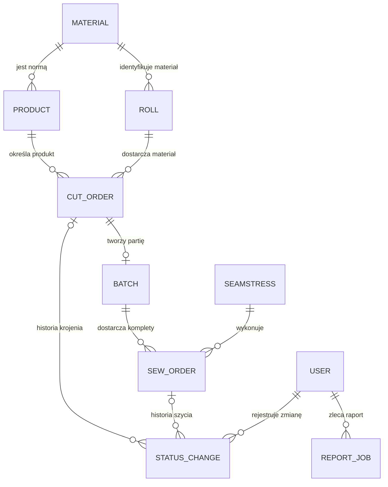

# Szwalnia

Aplikacja do zarządzania obiegiem produkcji w szwalni. Rejestruje stan materiałów, rezerwuje metraż pod krojenie, tworzy partie wykrojów i rozdziela je do szycia. Raport tygodniowy pokazuje wykonane komplety, zużycie materiału i koszty.

## Technologie i architektura

- ASP.NET Core 10 i kontrolery REST API z dokumentacją Swagger/OpenAPI
- EF Core 10 i Microsoft SQL Server 2022 jako osobna usługa
- Vue 3, Vite i Tailwind CSS
- Nginx i Docker Compose
- xUnit i ASP.NET Core TestServer do testów

Kontroler odbiera DTO i przekazuje operację do serwisu. Serwisy stosują reguły z domeny i zapisują dane przez `AppDb`. Odpowiedzi API mają osobne DTO. Globalny handler zamienia błędy domenowe, konflikty współbieżności i błędy ograniczeń bazy na Problem Details.

## Uruchomienie

Potrzebny jest Docker z Compose i obsługą kontenerów linuksowych. Polecenia wykonaj w katalogu z `docker-compose.yaml`.

Windows PowerShell

```powershell
powershell -ExecutionPolicy Bypass -File .\scripts\setup.ps1
docker compose up --build
```

Linux lub macOS z OpenSSL

```bash
bash scripts/setup.sh
docker compose up --build
```

- Aplikacja jest dostępna pod [http://localhost:18080](http://localhost:18080).
- Dokumentacja API jest dostępna pod [http://localhost:18080/swagger/index.html](http://localhost:18080/swagger/index.html).
- Konta startowe to `admin` (administrator), `worker` (krojenie) i `sewing` (szycie). Hasła znajdziesz w lokalnym `.env` pod kluczami `ADMIN_PASSWORD`, `WORKER_PASSWORD` i `SEWING_PASSWORD`. Inicjalizacja tworzy konta tylko wtedy, gdy ich jeszcze nie ma.
- `SEED_DEMO=true` dodaje przykładowy produkt, belkę i wykonawcę do pustego katalogu. `APP_PORT` ustawia port strony.
- Migracje EF Core stosują się przy starcie backendu. `docker compose down` zatrzymuje usługi i zachowuje dane w wolumenach.

Przy samodzielnym uruchomieniu API ustaw `ConnectionStrings__Default`, `Seed__AdminPassword`, `Seed__WorkerPassword` i `Seed__SewingPassword`. Ustaw `ASPNETCORE_URLS=http://localhost:5080` do współpracy z proxy Vite. Dla lokalnego HTTP ustaw także `Security__SecureCookies=false`. Frontend uruchom poleceniami `npm ci` i `npm run dev` w `Szwalnia.Website`.

### Aktualizacja poprzedniej wersji

Skopiuj zawartość nowej paczki do katalogu, z którego wcześniej uruchamiałeś Compose, zachowując dotychczasowy plik `.env` oraz nazwę projektu Compose. Uruchom ponownie skrypt setup, żeby dodać `SEWING_PASSWORD`, a potem wykonaj `docker compose up --build`. Migracja przypisze dotychczasowym kontom `Worker` rolę krojenia. Zaloguj się ponownie na tych kontach. Administrator może zmienić przydział w zakładce **Użytkownicy**.

## Funkcje i reguły

- Administrator ma dostęp do obu etapów produkcji, zarządza kontami i katalogami oraz generuje raporty tygodniowe.
- Pracownik krojenia widzi zlecenia krojenia. Pracownik szycia widzi zlecenia szycia i partie, które może przydzielić chałupniczkom.
- Przegląd szycia pokazuje planowaną liczbę kompletów przed zakończeniem krojenia oraz gotowe komplety. Przycisk przydziału pojawia się po zakończeniu krojenia i pozwala wskazać chałupniczkę, ilość i termin.
- Krojenie wymaga zgodnego materiału i szerokości belki. Nowe zlecenie rezerwuje dostępne metry według normy produktu. Zakończenie rozlicza rzeczywiste zużycie, zwalnia rezerwację i tworzy partię. Usunięcie zlecenia w kolejce zwalnia rezerwację.
- Szycie korzysta z partii powstałej po krojeniu. Nie można przydzielić więcej kompletów, niż jest dostępnych. Zmiany statusów przechodzą wyłącznie przez kolejne etapy i trafiają do historii.
- Stawki i normy używane do wyliczeń są kopiowane do zlecenia przy jego utworzeniu. Edycja normy produktu nie zmienia wcześniejszych kalkulacji.
- Przegląd pokazuje stan produkcji. Listy zleceń mają paginację po 20 rekordów i filtry po statusie i tekście. Szycie można też filtrować po wykonawcy.
- `POST /api/reports` zapisuje zadanie w SQL Serverze i zwraca `202 Accepted`. `ReportWorker` generuje wynik w tle. Po wygaśnięciu dzierżawy nieukończone zadanie może zostać podjęte ponownie. Raport obejmuje wykonania od poniedziałku do końca niedzieli w strefie Europe/Warsaw.
- Blokada optymistyczna używa wersji rekordu SQL Server. API zwraca `409 Conflict` przy zapisie na podstawie nieaktualnej wersji.

## Model danych



## REST API

Swagger zawiera schematy requestów i odpowiedzi. Zaloguj się przez `POST /api/auth/login`, podając `name` i `password`. Przeglądarka przechowuje ciasteczko sesji z flagą HttpOnly. Wywołania zmieniające dane wymagają nagłówka `X-Requested-With: Szwalnia`, który frontend i Swagger UI dodają automatycznie.

| Endpoint | Operacje |
| --- | --- |
| `/api/auth/login`, `/api/auth/logout`, `/api/auth/me` | Logowanie, wylogowanie i odczyt sesji |
| `/api/auth/users` | GET i POST oraz PUT `/{id}/role` tylko dla administratora |
| `/api/catalog/options` | GET danych katalogu dostępnych dla roli użytkownika |
| `/api/catalog/{materials,products,rolls,seamstresses}` | POST oraz PUT i DELETE z `/{id}` tylko dla administratora |
| `/api/cuts`, `/api/sews` | GET listy, POST, GET/PUT/DELETE rekordu oraz POST `/{id}/status`. Administrator ma dostęp do obu zasobów, pracownik do przypisanego etapu. |
| `/api/dashboard`, `/api/history/{resource}/{id}` | GET liczników lub historii dostępnych dla roli użytkownika |
| `/api/reports`, `/api/reports/{id}` | GET listy lub raportu i POST nowego zadania tylko dla administratora |
| `/health` | GET stanu połączenia z bazą |

Parametry listy zleceń obejmują `page`, `search`, `status` oraz `seamstressId` dla szycia. Przy edycji zlecenia i zmianie statusu przekaż `version` w JSON. Przy edycji katalogu i usuwaniu prześlij `version` jako zakodowany parametr query. Pobierz aktualną wersję z odpowiedzi odczytu.

## Testy

Testy jednostkowe działają bez bazy.

```powershell
dotnet test --filter "Category!=Integration"
```

Testy integracyjne wymagają SQL Servera i uprawnienia do utworzenia bazy. Przed ich uruchomieniem ustaw `SZWALNIA_TEST_SQL` na connection string do serwera testowego. Jeśli korzystasz z usługi `db` z Docker Compose, jest ona dostępna na `localhost,14333`. Podaj użytkownika `sa` i wartość `SQL_PASSWORD` z lokalnego `.env`.

```powershell
dotnet test --filter "Category=Integration"
```

Każde uruchomienie zestawu integracyjnego tworzy własną losowo nazwaną bazę, wykonuje migrację i usuwa tę bazę po testach. Testy obejmują logowanie i wylogowanie, role, rezerwację, konflikt wersji, filtrowanie, CRUD krojenia oraz pełny przepływ z raportem asynchronicznym.
