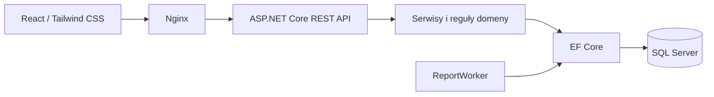
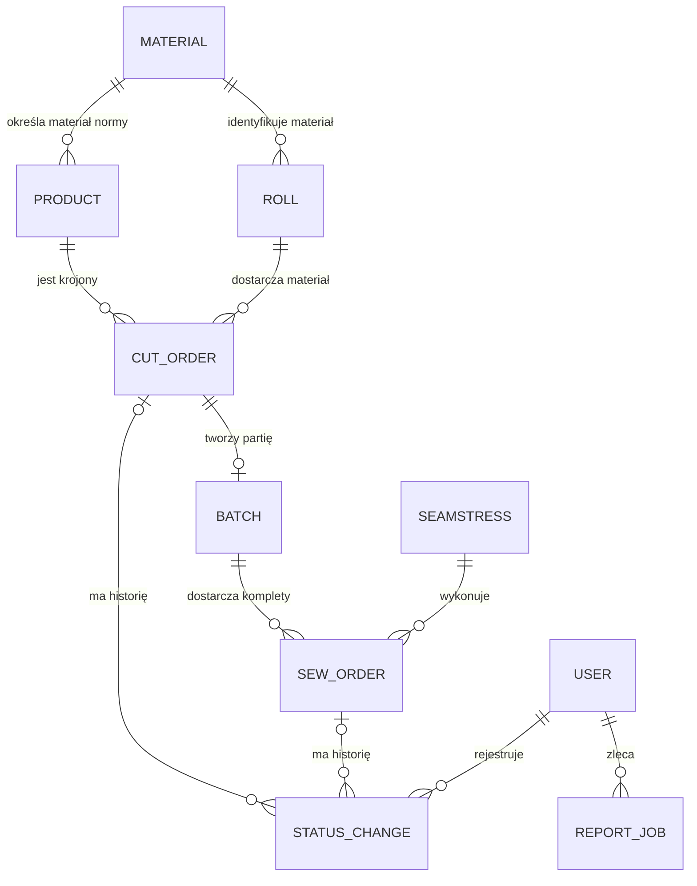

# Szwalnia

Szwalnia to aplikacja do zarządzania produkcją od przyjęcia belki materiału po rozliczenie gotowych kompletów. Łączy magazyn materiałów, zlecenia krojenia, przydział partii do szycia i tygodniowe raporty kosztów.

## Szybki start

Wymagany jest Docker z poleceniem `docker compose` i obsługą kontenerów Linux. Uruchom poniższe polecenia w katalogu zawierającym `docker-compose.yaml`.

**Windows (PowerShell)**

```powershell
powershell -NoProfile -ExecutionPolicy Bypass -File .\scripts\setup.ps1
docker compose up -d --build
docker compose ps
```

**Linux lub macOS (Bash i OpenSSL)**

```bash
bash scripts/setup.sh
docker compose up -d --build
docker compose ps
```

Skrypt tworzy w lokalnym `.env` brakujące hasła i zachowuje istniejące wartości. SQL Server stosuje migracje przy pierwszym starcie API. Poczekaj, aż baza i backend będą miały status `healthy`.

| Adres | Przeznaczenie |
| --- | --- |
| [http://localhost:18080](http://localhost:18080) | Panel Szwalnia |
| [http://localhost:18080/swagger/index.html](http://localhost:18080/swagger/index.html) | Dokumentacja i konsola REST API |
| [http://localhost:18080/health](http://localhost:18080/health) | Stan połączenia API z bazą |

| Login | Wartość hasła w `.env` | Uprawnienia |
| --- | --- | --- |
| `admin` | `ADMIN_PASSWORD` | Cała produkcja, katalogi, użytkownicy i raporty |
| `worker` | `WORKER_PASSWORD` | Krojenie, przegląd krojenia i historia zleceń krojenia |
| `sewing` | `SEWING_PASSWORD` | Szycie, dostępne partie, przydziały i historia zleceń szycia |

`SQL_PASSWORD` służy kontu `sa` w lokalnym kontenerze SQL Server. Opcjonalnie ustaw `APP_PORT` (domyślnie `18080`) oraz `SEED_DEMO=false`, jeśli chcesz zacząć bez przykładowego katalogu. Przy domyślnym `SEED_DEMO=true` aplikacja tworzy demonstracyjny produkt, belkę i chałupniczkę, jeśli tabela materiałów jest pusta. Hasła kont startowych są używane przy tworzeniu tych kont. Edycja `.env` po inicjalizacji bazy nie zmienia zapisanych haseł aplikacji.

```sh
docker compose logs -f backend db
docker compose down
```

Polecenie `down` zatrzymuje usługi i zachowuje wolumeny. Jeśli aktualizujesz istniejące wdrożenie, użyj tej samej nazwy projektu Compose i zachowaj dotychczasowy `.env` oraz kopię bazy. Uruchom ponownie skrypt setup, aby uzupełnić `SEWING_PASSWORD`. W tej paczce migracja EF Core tworzy schemat od zera. Istniejącą bazę pochodzącą z innej historii migracji sprawdź przed aktualizacją.

Compose publikuje porty wyłącznie na interfejsie lokalnym. Konfigurację HTTP i Swaggera przygotowano do prezentacji lokalnej. Dla wdrożenia zewnętrznego potrzebna jest konfiguracja HTTPS, `Security__SecureCookies=true` i osobne zarządzanie sekretami. Plik `.env` pozostaje lokalny, a `.env.example` dokumentuje nazwy zmiennych.

## Technologie i struktura

| Katalog | Odpowiedzialność |
| --- | --- |
| `Szwalnia.API/Controllers` i `DTO` | REST API w ASP.NET Core 10, walidacja, kontrakty żądań i odpowiedzi |
| `Szwalnia.API/Services` i `Domain` | Reguły produkcyjne, autoryzacja sesji, obsługa błędów i generowanie raportów |
| `Szwalnia.API/Data` i `Migrations` | EF Core 10, migracja i trwały zapis w SQL Server 2022 |
| `Szwalnia.Website/src/app` | Układ, nawigacja i koordynacja operacji między modułami |
| `Szwalnia.Website/src/_Auth` | Formularz logowania, odtworzenie i wygaszanie sesji oraz role |
| `Szwalnia.Website/src/modules` | Przegląd, zlecenia produkcyjne, katalog i partie, edycja, raporty oraz użytkownicy |
| `Szwalnia.Website/src/shared` | Klient REST, odświeżanie danych, formatowanie i wspólne komponenty |
| `Szwalnia.Tests` | Testy xUnit oraz testy HTTP za pomocą ASP.NET Core TestServer |

Frontend używa React 19, Vite i Tailwind CSS. W Compose Nginx serwuje zbudowany frontend i przekazuje `/api`, `/swagger` oraz `/health` do backendu. Dzięki wspólnemu origin przeglądarka automatycznie dołącza ciasteczko sesji do żądań API.



Przykładowy przepływ zapisu zaczyna się w formularzu krojenia. Kontroler waliduje DTO i rolę, a serwis odczytuje normę produktu i stan belki. Przy zgodnym materiale, szerokości i dostępnej ilości EF Core zapisuje w jednej operacji rezerwację, zlecenie i wpis historii. API oddaje `201 Created` z adresem nowego rekordu.

## Funkcje i reguły produkcyjne

1. Administrator zarządza materiałami, belkami, produktami i normami, chałupniczkami oraz kontami.
2. Krojenie rezerwuje metraż z belki zgodnej z normą produktu. Edycja zlecenia w kolejce zmienia rezerwację, a usunięcie ją zwalnia. Zakończenie krojenia rozlicza rzeczywiste zużycie, zwalnia rezerwację i tworzy partię wykrojów.
3. Szycie przydziela dostępne komplety z partii do chałupniczki. Zlecenia szycia w stanie `New` można edytować lub usunąć. Usunięcie zwalnia przydział kompletów.
4. Statusy przechodzą kolejno przez `Queued → Cutting → Cut` i `New → Sewing → Sewn`. Historia pokazuje czas zmiany i użytkownika. Terminy nowych i edytowanych zleceń muszą przypadać najwcześniej w bieżącym dniu w strefie `Europe/Warsaw`.
5. Stawki i normy są zapamiętywane przy tworzeniu zleceń. Wersja `rowversion` z SQL Servera chroni zapisy przed nadpisaniem zmian innego użytkownika. Konflikt zwraca `409 Conflict`.
6. Raport tygodniowy zestawia wykonane komplety, zużycie materiału i koszty. API zapisuje trwałe zadanie i oddaje `202 Accepted`. `ReportWorker` podejmuje je w tle z dzierżawą, którą można przejąć po wygaśnięciu. Frontend odświeża status i udostępnia gotowy wynik w JSON. Granice tygodnia liczone są w strefie `Europe/Warsaw`.

## Model danych



Wpis historii ma powiązanie z jednym z dwóch rodzajów zlecenia. `ReportJob` przechowuje parametry, stan wykonania oraz wynik raportu.

## REST API

Zaloguj się przez `POST /api/auth/login` z obiektem JSON `{ "name": "admin", "password": "…" }`. API zwraca informacje o użytkowniku i ustawia ciasteczko `Szwalnia.Session` z flagą `HttpOnly`. Do operacji zmieniających dane, w tym logowania, dodaj nagłówek `X-Requested-With: Szwalnia`. React i Swagger UI dodają go automatycznie. Backend sprawdza rolę przy każdym chronionym żądaniu. Zmiana roli unieważnia wcześniejszą sesję pracownika.

| Zasób | Operacje | Dostęp |
| --- | --- | --- |
| `/api/auth/login` | `POST` logowanie | Publiczny |
| `/api/auth/me`, `/api/auth/logout` | `GET` odczyt sesji, `POST` wylogowanie | Zalogowani |
| `/api/auth/users`, `/api/auth/users/{id}/role` | `GET` lista, `POST` konto, `PUT` rola pracownika | Administrator |
| `/api/catalog/options` | `GET` katalog przefiltrowany według roli | Zalogowani |
| `/api/catalog/{materials,products,rolls,seamstresses}` | `POST` rekord, `PUT` i `DELETE` pod `/{id}` | Administrator |
| `/api/cuts`, `/api/sews` | `GET` lista, `POST` rekord, `GET/PUT/DELETE` pod `/{id}`, `POST` pod `/{id}/status` | Administrator i pracownik odpowiedniego etapu |
| `/api/dashboard` | `GET` liczniki według roli | Zalogowani |
| `/api/history/{cuts,sews}/{id}` | `GET` historia zlecenia | Administrator i pracownik odpowiedniego etapu |
| `/api/reports`, `/api/reports/{id}` | `GET` lista lub stan i wynik; `POST` nowe zadanie z `weekStart` (data poniedziałku) | Administrator |
| `/health` | `GET` stan bazy | Publiczny na porcie aplikacji |

Listy zleceń zwracają `items`, `total`, `pageNumber` i `pageSize` (20). Parametry to `page`, `search`, `status` i dodatkowo `seamstressId` przy szyciu. Przy edycji zlecenia, zmianie statusu lub roli przekaż aktualną wartość `version` w JSON. Przy edycji katalogu i usuwaniu rekordów przekaż ją jako zakodowany parametr query.

API używa m.in. `200` dla odczytów, `201` dla nowych rekordów, `202` dla zlecenia raportu oraz `204` po zmianach bez treści odpowiedzi. Najczęstsze błędy to `400` (walidacja), `401` (brak sesji), `403` (brak uprawnień), `404` (brak rekordu), `409` (konflikt danych lub reguły) i `429` (limit logowań). Błędy walidacji i domeny korzystają z formatu Problem Details.

[Repozytorium GitHub](https://github.com/Holingo/System-Zarzadzania-Szwalnia-IO).
